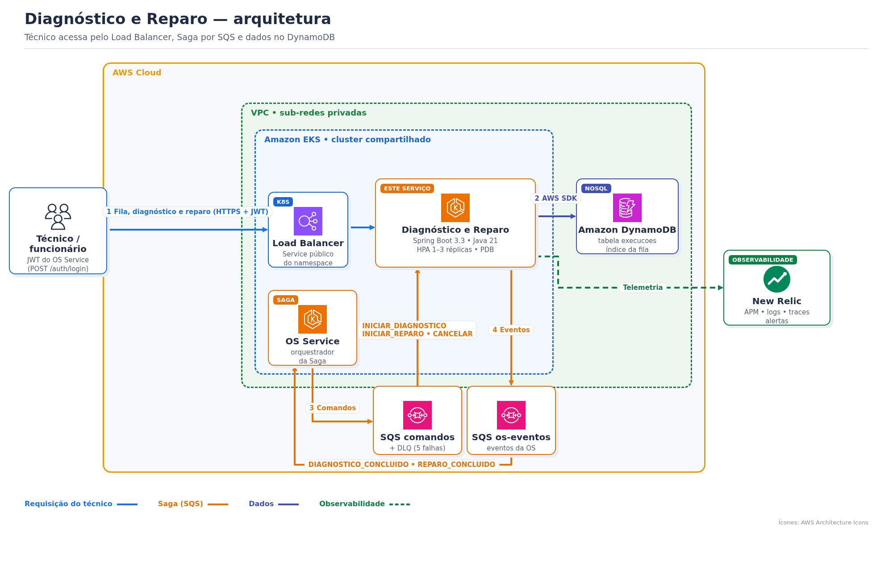
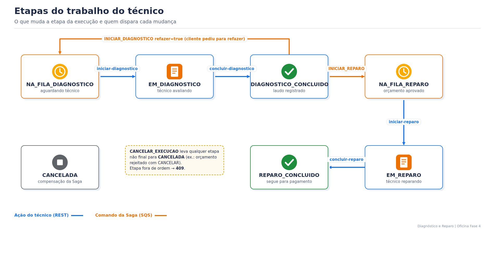

# Serviço de Diagnóstico e Reparo — Oficina Fase 4

> Tech Challenge FIAP SOAT — Fase 4. Documentação central da solução: [`oficina-os-service`](https://github.com/tiagomiele/oficina-os-service#readme).

## 1. Objetivo de negócio

Este serviço organiza o **trabalho do técnico** na oficina:

1. **Fila:** cada OS aberta entra na fila de diagnóstico, por ordem de chegada.
2. **Diagnóstico:** o técnico avalia o veículo e registra o laudo. O laudo é a base do orçamento.
3. **Reparo:** quando o cliente aprova o orçamento, a OS entra na fila de reparo. O técnico executa o serviço e conclui o reparo, liberando a cobrança.

Se o cliente rejeitar o orçamento pedindo para **refazer**, a OS volta para a fila de diagnóstico, marcada como retrabalho.

## 2. Requisitos atendidos

**Funcionais**

| # | Requisito | Onde |
|---|---|---|
| RF1 | Criar a execução na fila quando a OS é aberta | comando `INICIAR_DIAGNOSTICO` |
| RF2 | Técnico vê a fila por etapa, em ordem de chegada | `GET /execucoes/fila?etapa=` |
| RF3 | Iniciar o diagnóstico → `DIAGNOSTICO_INICIADO` | `POST /execucoes/{numeroOs}/iniciar-diagnostico` |
| RF4 | Concluir o diagnóstico com laudo → `DIAGNOSTICO_CONCLUIDO` | `POST /execucoes/{numeroOs}/concluir-diagnostico` |
| RF5 | Orçamento aprovado coloca a OS na fila de reparo | comando `INICIAR_REPARO` |
| RF6 | Iniciar e concluir o reparo → `REPARO_CONCLUIDO` | `POST .../iniciar-reparo` e `.../concluir-reparo` |
| RF7 | Refazer o diagnóstico quando o cliente pede | `INICIAR_DIAGNOSTICO` com `refazer=true` |
| RF8 | Compensação: cancelar a execução | comando `CANCELAR_EXECUCAO` |
| RF9 | Consultar a execução de uma OS | `GET /execucoes/{numeroOs}` |

**Técnicos**

| Requisito | Como |
|---|---|
| Banco próprio (NoSQL) | Amazon DynamoDB exclusivo, `PAY_PER_REQUEST`, criptografado, com índice da fila |
| Concorrência | escrita condicional pela `versao` (controle otimista); conflito → `409` |
| Comunicação assíncrona | Amazon SQS: consome `diagnostico-reparo-comandos`, publica em `os-eventos`; DLQ após 5 falhas |
| Idempotência | a execução guarda os últimos 20 `messageId`; a máquina de etapas rejeita fora de ordem |
| Segurança | JWT HS256 do OS Service, perfis `TECNICO_DA_OFICINA` e `FUNCIONARIO_DA_OFICINA` |
| Rastreabilidade | `correlationId` da Saga gravado na execução, em todos os eventos e no MDC dos logs; New Relic APM |
| Qualidade | Clean Architecture validada por ArchUnit, JaCoCo ≥ 80% (linhas e branches), SonarCloud, Trivy, Gitleaks, SBOM |
| Escalabilidade | EKS com HPA por CPU (1 a 3 réplicas) e PDB |

## 3. Stack técnica

Java 21 · Spring Boot 3.3 (Web, Validation, Security, Actuator) · AWS SDK v2 (DynamoDB e SQS) · springdoc-openapi 2.6 (Swagger) · JUnit 5, Testcontainers (LocalStack), ArchUnit, JaCoCo · Spotless · Docker · Kubernetes (EKS) · GitHub Actions + GHCR · SonarCloud · New Relic Java agent.

## 4. Arquitetura



O técnico acessa direto pelo Load Balancer do serviço, sem passar pelo API Gateway: o API Gateway só expõe as rotas do cliente.

| Pacote | Responsabilidade |
|---|---|
| `domain` | `Execucao` e a máquina de etapas `EtapaExecucao`, sem Spring |
| `usecase` | `ExecucaoService` e as portas (`ExecucaoRepository`, `MensageriaGateway`) |
| `adapter` | REST, DynamoDB/memória, SQS/memória e JWT |
| `infrastructure` | configuração (segurança, OpenAPI, DynamoDB, mensageria) |

**Etapas da execução**



## 5. Participação na Saga

Contrato completo: [`oficina-os-service/docs/saga/contrato-mensagens.md`](https://github.com/tiagomiele/oficina-os-service/blob/homolog/docs/saga/contrato-mensagens.md).

| Recebe (fila `oficina-<env>-diagnostico-reparo-comandos`) | Efeito |
|---|---|
| `INICIAR_DIAGNOSTICO` | cria a execução em `NA_FILA_DIAGNOSTICO`; com `refazer=true`, volta para a fila como retrabalho |
| `INICIAR_REPARO` | `DIAGNOSTICO_CONCLUIDO` → `NA_FILA_REPARO` |
| `CANCELAR_EXECUCAO` | compensação: execução `CANCELADA` |

| Ação do técnico | Publica (fila `oficina-<env>-os-eventos`) |
|---|---|
| `iniciar-diagnostico` | `DIAGNOSTICO_INICIADO` (não repete no retrabalho) |
| `concluir-diagnostico` | `DIAGNOSTICO_CONCLUIDO` (`diagnostico` = laudo) |
| `iniciar-reparo` | — |
| `concluir-reparo` | `REPARO_CONCLUIDO` |

Comando com falha não é apagado da fila. Depois de 5 tentativas, vai para a DLQ `oficina-<env>-diagnostico-reparo-comandos-dlq`.

## 6. API (Swagger)

Todas as rotas `/execucoes/**` exigem o token de funcionário ou técnico (`POST <BACKEND_BASE_URL>/auth/login` do OS Service).

| Método | Rota | Resultado |
|---|---|---|
| GET | `/execucoes/fila?etapa=NA_FILA_DIAGNOSTICO` | fila da etapa, da OS mais antiga para a mais nova (`NA_FILA_REPARO` para a fila de reparo) |
| GET | `/execucoes/{numeroOs}` | execução atual |
| POST | `/execucoes/{numeroOs}/iniciar-diagnostico` | `EM_DIAGNOSTICO` |
| POST | `/execucoes/{numeroOs}/concluir-diagnostico` | corpo `{"diagnostico":"..."}` → `DIAGNOSTICO_CONCLUIDO` |
| POST | `/execucoes/{numeroOs}/iniciar-reparo` | `EM_REPARO` |
| POST | `/execucoes/{numeroOs}/concluir-reparo` | `REPARO_CONCLUIDO` |
| GET | `/actuator/health` | saúde (público) |

**Erros:**
- `400`: laudo vazio, laudo com mais de 2000 caracteres ou etapa inexistente.
- `401`: sem token ou token expirado (15 min).
- `403`: token de cliente.
- `404`: a OS ainda não tem execução.
- `409`: etapa fora de ordem ou alteração concorrente.

404 e 409 vêm no formato Problem Details:

```json
{"type":"about:blank","title":"Conflict","status":409,"detail":"Execução em NA_FILA_DIAGNOSTICO não pode ir para REPARO_CONCLUIDO","instance":"/execucoes/OS-102026-000003/concluir-reparo"}
```

**Abrir o Swagger:**

```powershell
# local
Start-Process http://localhost:8080/swagger-ui.html
# AWS (troque production por homolog)
$lb = kubectl get svc oficina-diagnostico-reparo -n oficina-diagnostico-reparo-production -o jsonpath='{.status.loadBalancer.ingress[0].hostname}'
Start-Process "http://$lb/swagger-ui.html"
```

Em **Authorize**, cole o token do funcionário. O contrato bruto fica em `/v3/api-docs`.

## 7. Banco de dados (DynamoDB)

**Objetivo:** guardar o andamento do trabalho do técnico, com um item por OS. O banco é isolado: nenhum outro serviço o acessa. Recurso: tabela `oficina-<env>-execucoes`, criada pelo [`oficina-database-infra/diagnostico-reparo`](https://github.com/tiagomiele/oficina-database-infra/tree/homolog/diagnostico-reparo).

| Atributo | Conteúdo |
|---|---|
| `numeroOs` (chave) | número da OS |
| `etapa`, `entradaFilaEm` | etapa atual e entrada na fila. São a chave do índice `etapa-entradaFilaEm-index`, que monta a fila |
| `idCliente`, `placa`, `descricaoProblema` | dados recebidos no `INICIAR_DIAGNOSTICO` |
| `diagnostico`, `retrabalho` | laudo e indicação de refazer |
| `correlationId` | id da Saga, para rastrear nos logs |
| `versao` | controle otimista |
| `mensagensProcessadas` | últimos 20 `messageId` (idempotência) |
| `atualizadoEm` | última alteração |

**Ver os dados:** o DynamoDB não fica em rede privada, por isso não precisa de túnel. Use as credenciais do Lab.

```powershell
$t = 'oficina-production-execucoes'   # ou oficina-homolog-execucoes
# todas as execuções
aws dynamodb scan --table-name $t --region us-west-2 --query 'Items[].{os:numeroOs.S,etapa:etapa.S,atualizado:atualizadoEm.S}' --output table
# uma OS
aws dynamodb get-item --table-name $t --region us-west-2 --key '{\"numeroOs\":{\"S\":\"OS-102026-000003\"}}'
# fila do técnico, como o serviço lê
aws dynamodb query --table-name $t --region us-west-2 --index-name etapa-entradaFilaEm-index --key-condition-expression 'etapa = :e' --expression-attribute-values '{\":e\":{\"S\":\"NA_FILA_DIAGNOSTICO\"}}' --query 'Items[].numeroOs.S'
```

No console da AWS: **DynamoDB → Tables → `oficina-<env>-execucoes` → Explore table items**.

## 8. Executar

**Pré-requisitos:** Java 21 e Docker.

**Testes e build (recomendado para avaliar):**

```powershell
./mvnw spotless:apply
./mvnw verify   # unitários + integração DynamoDB/SQS no LocalStack (Testcontainers), ArchUnit e JaCoCo ≥ 80%
start target/site/jacoco/index.html
```

**Subir só este serviço localmente** (DynamoDB e mensageria em memória):

```powershell
./mvnw spring-boot:run
# http://localhost:8080/swagger-ui.html
```

**Os 3 serviços juntos com a Saga real:** use o BDD do OS Service, em [`oficina-os-service/bdd`](https://github.com/tiagomiele/oficina-os-service/tree/homolog/bdd).

**Na AWS:** siga o Bootstrap da Fase 4, na documentação central. A tabela e as filas vêm do `oficina-database-infra`.

## 9. Configuração

| Variável | Padrão | Uso |
|---|---|---|
| `PERSISTENCIA_TIPO` | `memoria` | `dynamodb` na AWS |
| `DYNAMODB_TABLE_NAME` | `oficina-local-execucoes` | tabela |
| `MENSAGERIA_TIPO` | `memoria` | `sqs` na AWS |
| `SQS_DIAGNOSTICO_REPARO_COMANDOS_URL` / `SQS_OS_EVENTOS_URL` | — | filas, gravadas pelo `configure-environment.ps1` |
| `AWS_SQS_ENDPOINT` / `AWS_DYNAMODB_ENDPOINT` | — | só no LocalStack |
| `JWT_SECRET` | — | mesmo valor do OS Service |

## 10. CI/CD

| Workflow | Quando | O que faz |
|---|---|---|
| **CI** | PR e push | valida os workflows, roda build, testes e JaCoCo, SonarCloud (quality gate), SBOM CycloneDX/Dependency-Track, Trivy e Gitleaks |
| **CD** | push em `homolog`/`main` ou manual | publica a imagem no GHCR → `Deploy HOMOLOG` (branch `homolog`) ou `Deploy PRODUÇÃO` (`main`) |

O deploy aplica `k8s/` no namespace `oficina-diagnostico-reparo-<env>` e só roda com `DEPLOY_ENABLED=true`. Ele cria:
- Deployment com 384–640 Mi;
- HPA de 1 a 3 réplicas, por CPU a 70%;
- PDB;
- Service LoadBalancer público.

Depois, faz um smoke test do `/actuator/health/readiness` e publica a URL no resumo do job.


### Evidência de cobertura de testes

O build falha se a cobertura ficar abaixo de 80% (JaCoCo, `jacoco.minimum.coverage = 0.80` no `pom.xml`). Último CI verde em `homolog` (02/11/2026, 39 testes):

| Linhas | Instruções | Branches | Relatório |
|---|---|---|---|
| 99,4% | 99,2% | 92,5% | artefato `jacoco-report` do [run 41476675173](https://github.com/tiagomiele/oficina-diagnostico-reparo-service/actions/runs/41476675173) |

Quality Gate do SonarCloud: [painel do projeto](https://sonarcloud.io/summary/overall?id=tiagomiele_oficina-diagnostico-reparo-service&branch=homolog). Para gerar o relatório local: `./mvnw verify` e abra `target/site/jacoco/index.html`.

## 11. Observabilidade

New Relic APM `oficina-diagnostico-reparo-service-<env>`: agente Java, distributed tracing e logs em JSON (perfil `prod`) com o `correlationId` da Saga. Dashboard, alertas e profundidade das DLQs: [`oficina-kubernetes-infra`](https://github.com/tiagomiele/oficina-kubernetes-infra#readme).

```powershell
kubectl logs -n oficina-diagnostico-reparo-production deploy/oficina-diagnostico-reparo --tail 200 | Select-String 'Comando|DIAGNOSTICO_|REPARO_'
```
